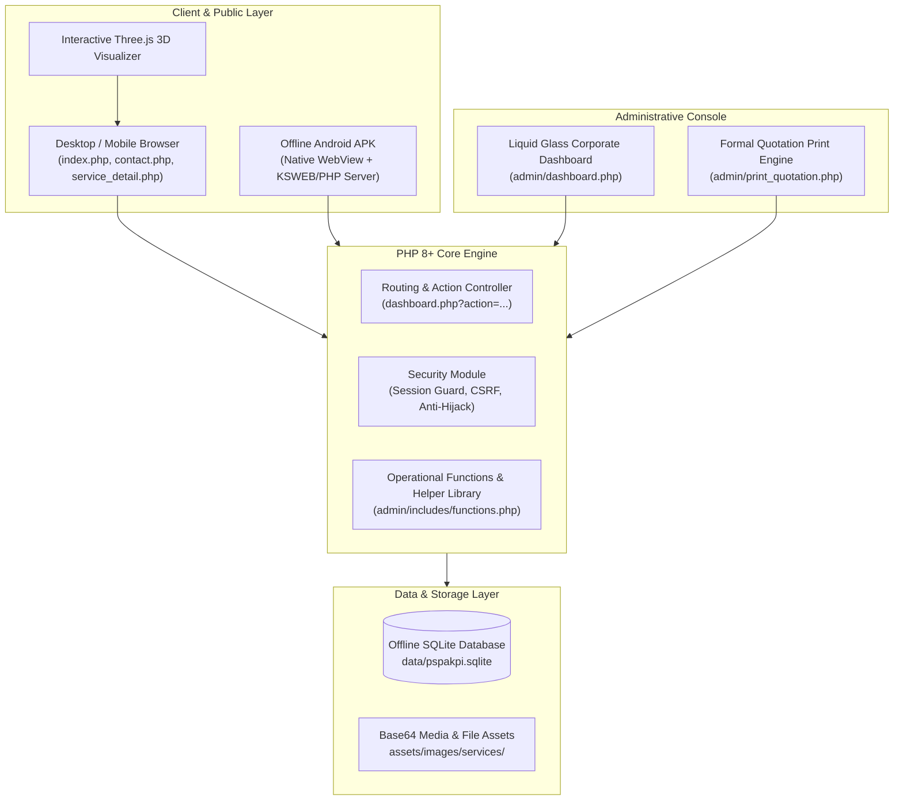
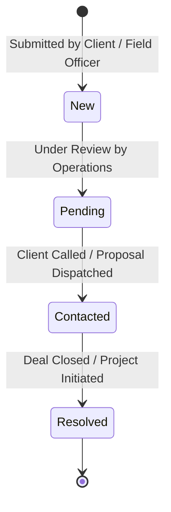

# P.S. PAKPI ENTERPRISES — SOFTWARE APPLICATION INDUCTION MANUAL
**System Name:** PS-Pakpi Multi-Sector Operations & Administration Platform  
**Document Version:** 2.4.0 (Offline-First Edition)  
**Effective Date:** October 2026  
**Classification:** Confidential & Internal Operations  

---

## 1. DOCUMENT CONTROL & WELCOME

### 1.1 Welcome Message
Welcome to **P.S. Pakpi Enterprises**! You are onboarding into an integrated multi-sector operational suite engineered to handle our diverse commercial operations—ranging from civil construction and heavy supply procurement to professional business consultancy and commercial bakery services.

This **Induction Manual** serves as your authoritative reference for:
1. Understanding the system architecture and business logic.
2. Operating the **Liquid Glass 2026 Admin Dashboard**.
3. Administering clients, services, multi-tier quotations, and customer inquiries.
4. Managing field operations through our **Offline Android APK**.
5. Maintaining system security, database integrity, and server stability.

### 1.2 Target Audience
* **Executive Administrators:** Oversee business analytics, team permissions, and enterprise settings.
* **Operations & Sales Desk:** Manage quotation packages, process client inquiries, and schedule follow-ups.
* **Field Officers & Representatives:** Utilize the offline Android application on site for service presentations and inquiry capture.
* **Software Engineers & IT Support:** Deploy, maintain, backup, and extend the PHP/SQLite codebase.

---

## 2. ENTERPRISE OVERVIEW & BUSINESS DIVISIONS

P.S. Pakpi Enterprises operates across five primary business divisions, unified under a single platform:

```
                      ┌─────────────────────────────────────────┐
                      │        P.S. PAKPI ENTERPRISES           │
                      │       Unified Business Platform         │
                      └────────────────────┬────────────────────┘
                                           │
         ┌───────────────────┬─────────────┴───────┬───────────────────┐
         │                   │                     │                   │
┌────────▼────────┐ ┌────────▼────────┐ ┌──────────▼────────┐ ┌────────▼────────┐
│  Civil & Site   │ │  Supply Works   │ │    Commercial     │ │ Professional   │
│  Construction   │ │ & Procurement   │ │      Bakery       │ │  Consultancy   │
└─────────────────┘ └─────────────────┘ └───────────────────┘ └────────────────┘
                                           │
                                ┌──────────▼────────┐
                                │   Many More /     │
                                │  Custom Projects  │
                                └───────────────────┘
```

1. **Civil & Site Construction:** Building construction, structural contracts, site coordination, and project engineering.
2. **Supply Works & Procurement:** Bulk commercial supply, logistics, materials procurement, and delivery management.
3. **Commercial Bakery:** Artisan bakery production, bulk event supply, and customized retail orders.
4. **Professional Consultancy:** Corporate advisory, documentation, regulatory compliance, and business strategy.
5. **Many More / Custom Sectors:** Tailored multi-industry services covering public infrastructure, healthcare, and education.

---

## 3. SYSTEM ARCHITECTURE & TECHNICAL STACK

### 3.1 High-Level Architecture



### 3.2 Technology Stack Specifications
* **Server Language:** PHP 8.0+ (Vanilla procedural architecture with PDO).
* **Database Engine:** SQLite 3 (stored at `data/pspakpi.sqlite` with Foreign Keys enabled: `PRAGMA foreign_keys = ON`).
* **Client Frontend:** Semantic HTML5, CSS3 Custom Properties, Modern Flexbox, FontAwesome 6, Three.js 3D Canvas.
* **Admin Frontend:** "Liquid Glass 2026" Advanced Glassmorphism (`admin-glass.css`), CSS Backdrop Filters, Fluid Flex Layout.
* **Mobile Runtime:** Android SDK 34 (Java Native WebView wrapper in `android-apk`), local loopback HTTP server (`127.0.0.1:8080`).
* **PDF / Print Engine:** Native Print CSS with automated 18% GST calculation and Indian Number-to-Words currency conversion.

---

## 4. DIRECTORY & CODEBASE STRUCTURE

```text
ps-pakpi/
│
├── admin/                         # Administrative Back-Office Application
│   ├── includes/
│   │   └── functions.php          # Core business logic, queries, and helper functions
│   ├── dashboard.php              # Main action controller (CRUD operations & data preparation)
│   ├── dashboard_template.php     # Liquid Glass admin view template (HTML/UI)
│   ├── login.php                  # Secure administrative authentication gateway
│   ├── logout.php                 # Session termination and cleanup
│   ├── security.php               # Session timeout (30 min) and anti-hijacking guard
│   ├── print_quotation.php        # Printable / exportable formal quotation sheet
│   ├── delete_quote.php           # Specialized quote deletion handler
│   ├── get_quote.php              # Quote retrieval endpoint
│   ├── save_quote.php             # Quote configuration persistence handler
│   └── error.log                  # Admin runtime diagnostic log
│
├── android-apk/                   # Offline Android Application Project
│   ├── app/src/main/
│   │   ├── java/com/pspakpi/offline/MainActivity.java # Native WebView controller
│   │   ├── res/                   # Native layouts, drawables, and UI chips
│   │   └── AndroidManifest.xml    # App permissions & network security configs
│   ├── build.gradle               # Gradle build configuration
│   └── release-keystore.jks       # APK signing key
│
├── assets/                        # Static Presentation Assets
│   ├── admin-glass.css            # 2026 Liquid Glass Admin theme (responsive flex)
│   ├── style.css                  # Core public styles
│   ├── enterprise-theme.css       # Enterprise palette and variables
│   ├── js/three-scene.js          # Interactive Three.js 3D abstract visualizer
│   └── images/                    # Branding logos, icons, and service graphics
│
├── data/                          # Persistent Storage (Excluded from VCS)
│   └── pspakpi.sqlite             # Primary SQLite application database
│
├── 3d-view.php                    # Standalone 3D interactive showcase
├── config.php                     # Global environment configs, DB connection, auto-migrator & seeder
├── contact.php                    # Public Quick Quote routing portal
├── db.php                         # Shared DB handle accessor
├── footer.php                     # Public global footer
├── header.php                     # Public global header
├── index.php                      # Public homepage & editorial corporate showcase
├── inquirySuccess.php             # Inquiry confirmation & dispatch view
├── OFFLINE_ANDROID_NOTES.md       # Notes for packaging & running on mobile
└── service_detail.php             # Detailed service specs, package tiers, and inquiry form
```

---

## 5. ENVIRONMENT SETUP & DEPLOYMENT GUIDE

### 5.1 Local Server Requirements
* **Web Server:** Apache 2.4+ (XAMPP / WampServer / KSWEB / Nginx).
* **PHP Engine:** PHP 8.0, 8.1, or 8.2+.
* **PHP Extensions Required:**
  * `pdo_sqlite` (Mandatory for database connection).
  * `fileinfo` (Required for secure MIME-type validation of image uploads).
  * `json` (For array/feature parsing).
  * `mbstring` (For multibyte string sanitization).

> [!IMPORTANT]
> **Enabling SQLite in XAMPP:**
> Open your active `php.ini` file (e.g., `D:\xampp\php\php.ini`) and ensure the following directive is uncommented (no leading semicolon):
> ```ini
> extension=pdo_sqlite
> ```
> Restart Apache after modifying `php.ini`.

### 5.2 Automated Database Initialization
The application contains self-healing and auto-seeding logic inside [config.php](file:///i:/C/htdocs/ps-pakpi/config.php).
On first launch:
1. The database folder `data/` is automatically created.
2. `data/pspakpi.sqlite` is generated if absent.
3. Tables (`admins`, `clients`, `services`, `service_quotes`, `service_inquiries`, `custom_fields`, `quote_custom_values`, `field_visibility`, `countries`, `industries`) are created.
4. Auto-migration adds any missing columns dynamically (`migrateOfflineDatabase()`).
5. Core services (Bakery, Construction, Consultancy, Supply Works, Many More) and seed data are populated.

### 5.3 Default Credentials
| Portal | Access URL | Username | Default Password | Role |
| :--- | :--- | :--- | :--- | :--- |
| **Admin Console** | `http://127.0.0.1/ps-pakpi/admin/` | `admin` | `admin123` | Master SuperAdmin |
| **Client Reset** | Auto-generated on creation | Email or Username | `welcome123` | Portal Client |

> [!CAUTION]
> **Mandatory Security Step:** The default password `admin123` MUST be modified immediately upon deploying to a production or shared environment!

---

## 6. STANDARD OPERATING PROCEDURES (SOPS)

### SOP-01: Admin Login & Session Management
1. Navigate to `http://127.0.0.1/ps-pakpi/admin/login.php`.
2. Input administrative username and password.
3. **Session Protections in Force:**
   * **Inactivity Auto-Logout:** Sessions automatically expire after 30 minutes (1,800 seconds) of idle time ([security.php](file:///i:/C/htdocs/ps-pakpi/admin/security.php)).
   * **Anti-Session Hijacking:** The session validates `$_SERVER['HTTP_USER_AGENT']`. If the user agent shifts during a session, the session is immediately invalidated.
4. To securely sign out, always click the **"Logout"** control in the sidebar.

---

### SOP-02: Dashboard Overview & KPI Analytics
Upon login, the home view (`dashboard.php?action=dashboard`) provides a live pulse of enterprise activities:

```
┌────────────────────────────────────────────────────────────────────────┐
│                        TOP NAVIGATION / BRAND                          │
├───────────────┬────────────────────────────────────────────────────────┤
│               │  [Total Clients] [Active Services] [Total Inquiries]  │
│   SIDEBAR     │  [Pending Leads] [Upcoming Follow-ups] [Quotes Active] │
│               ├────────────────────────────┬───────────────────────────┤
│ • Dashboard   │ Recent Inquiries           │ Quick Follow-up Calendar  │
│ • Clients     │ ────────────────────────── │ ───────────────────────── │
│ • Services    │ INQ#402 - ABC Corp (New)   │ Tomorrow: Follow-up on    │
│ • Quotes      │ INQ#401 - Apex Ltd (Pend.) │ Construction tender       │
│ • Inquiries   ├────────────────────────────┴───────────────────────────┤
│ • Visibility  │ System Status & Database Synchronization Status        │
└───────────────┴────────────────────────────────────────────────────────┘
```

* **Action Items:** Monitor the **Upcoming Follow-ups** section daily for scheduled customer meetings or quote expirations.

---

### SOP-03: Client Management
**Path:** `dashboard.php?action=clients`

* **Adding a New Client:**
  1. Click **"Add Client"**.
  2. Complete Full Name, Username, Email (must be unique), Phone, Company Name, and Address.
  3. The system automatically creates a unique formatted Client Identification Code: `CLYYYYMMDD<HEX6>` (e.g., `CL20261027AB12CD`).
  4. Passwords are encrypted using PHP's standard `password_hash()` with `PASSWORD_DEFAULT` (Bcrypt).
* **Resetting Client Password:**
  * Click **"Reset Password"** on any client row. The system resets their password to `welcome123`.
* **Client Statuses:**
  * `active`: Client can log in and view proposals.
  * `pending`: Registration awaiting administrative approval.
  * `inactive`: Account disabled.

---

### SOP-04: Service Catalog Administration
**Path:** `dashboard.php?action=services`

* **Adding or Updating Services:**
  1. **Title & Descriptions:** Provide a punchy Title, a short summary (`description`), and an exhaustive project overview (`detailed_description`).
  2. **Pricing & Durations:** Define minimum and maximum price ranges (or "Contact for pricing") and timeline boundaries (e.g., `1-3 months`).
  3. **Feature Badges:** Enter comma-separated feature bullets (e.g., `Planning, Execution support, Site coordination`).
  4. **Image Upload:**
     * Upload an image (PNG, JPG, WebP up to 10MB).
     * The system validates the MIME type with `finfo_file()` and encodes it into a safe Base64 data string, ensuring self-contained offline portability without missing external file paths.
  5. **Visibility Controls:** Toggle whether the service is visible to clients, whether price is shown, and whether clients can directly request quotes.

---

### SOP-05: Multi-Tier Quotation Engine
**Path:** `dashboard.php?action=quotes`

The system features a package configurator allowing multiple quote tiers per service (e.g., *Standard Package*, *Premium Tier*, *Turnkey Contract*).

```
┌────────────────────────────────────────────────────────────────────────┐
│                        QUOTE PACKAGE BUILDER                           │
├────────────────────────────────────────────────────────────────────────┤
│ Service: [ Civil Construction  ▼ ]    Quote Code: [ CON-2026-A ]       │
│ Title:   [ Full Structural Package ]  Category:   [ Commercial ]       │
├────────────────────────────────────────────────────────────────────────┤
│ Price Type: (•) Fixed Price  ( ) Price Range   Fixed: [$ 15,000.00]    │
│ Discount:   [ 5% ]  Description: [ Early Signing Incentive ]           │
├────────────────────────────────────────────────────────────────────────┤
│ Inclusions:      [ Structural steel, Foundation casting, Quality QA ]  │
│ Exclusions:      [ Interior furniture, Municipal licensing taxes ]     │
│ Prerequisites:   [ Soil test report approved, Site access road ]       │
│ Required Docs:   [ Land title deed, Authorized structural drawings ]   │
├────────────────────────────────────────────────────────────────────────┤
│ Client Visibility: [✔] Visible on Portal   [✔] Active for Proposals    │
└────────────────────────────────────────────────────────────────────────┘
```

1. **Configuring Inclusions & Exclusions:** Itemize scope boundaries clearly so quotes are legally binding and unambiguous.
2. **Prerequisites & Documents Required:** Specify mandatory prerequisites prior to work commencement.
3. **Discounts:** Specify percentage discounts with promotional explanations.

---

### SOP-06: Generating & Printing Formal Quotations
**Path:** `admin/print_quotation.php?id=<QUOTE_ID>&client=<CLIENT_NAME>`

* **Automated Calculations:**
  * **Sub-Total:** Derived from `fixed_price` or `min_price`.
  * **Discount:** Deducted automatically based on configured percentage.
  * **GST Tax Rate:** Automatically calculated at 18% on the discounted taxable amount.
  * **Grand Total:** Net payable amount.
* **Indian Currency in Words:** The system converts the final currency figure into words using the Indian numbering system (Lakhs, Crores, Rupees), ensuring commercial compliance.
* **Document Printing:** Trigger `Ctrl + P` or click **"Print Quotation"**. Custom print stylesheets format margins, page breaks, and company seals cleanly without header/footer artifacts.

---

### SOP-07: Inquiries & CRM Follow-up Pipeline
**Path:** `dashboard.php?action=inquiries`

Client inquiries submitted through the public portal or field APK are routed into the CRM pipeline.

#### Inquiry Status Lifecycle



* **Updating Notes & Scheduling:**
  1. Open the inquiry details card.
  2. Enter internal operational remarks in **Admin Notes**.
  3. Pick a **Follow-up Date**; this populates the dashboard follow-up calendar.
  4. Select new status (`pending`, `contacted`, `resolved`).
  5. Upon updating, the system automatically triggers a status email notification to the client's email address.
* **Deletion Safeguard:**
  > [!WARNING]
  > To prevent accidental loss of active business leads, **only inquiries marked as `resolved` can be deleted**. Attempting to delete an active inquiry will trigger a protective system rejection.

---

### SOP-08: Custom Fields & Field Visibility System
**Path:** `dashboard.php?action=custom_fields` and `dashboard.php?action=visibility`

1. **Dynamic Custom Fields:**
   * Create custom attributes for quotes (e.g., *Site Square Footage*, *Power Backup Requirements*, *Warranty Extension Years*).
   * Supported types: `text`, `number`, `textarea`, `select`, `date`.
2. **Field Visibility Switchboard:**
   * Administrators can toggle individual fields on or off across the public website and forms without writing code.
   * Modify visibility for service descriptions, duration, pricing badges, and custom quote inputs with a single checkbox.

---

## 7. PUBLIC PORTAL & CLIENT EXPERIENCE

```
[ Homepage: index.php ]
  │
  ├──► [ 3D Interactive Model: 3d-view.php ]
  │
  ├──► [ Quick Quote Navigator: contact.php ]
  │        └── (Direct 1-click routing to division specification)
  │
  └──► [ Service Detail & Specification: service_detail.php?id=X ]
           │
           ├── Package Comparison Cards (Inclusions, Exclusions, Duration)
           │
           └── Interactive Inquiry Submission Form
                   │
                   └──► [ Success Confirmation: inquirySuccess.php ]
```

* **Interactive 3D Engine:** [3d-view.php](file:///i:/C/htdocs/ps-pakpi/3d-view.php) leverages Three.js to render modern geometric representations of enterprise engineering and stability.
* **Lead Capture Validation:** [service_detail.php](file:///i:/C/htdocs/ps-pakpi/service_detail.php) validates phone numbers, emails, and organization details before dispatching to `service_inquiries`.

---

## 8. OFFLINE ANDROID OPERATIONS (FIELD APPS)

### 8.1 Philosophy & Setup
For remote sites, construction yards, and rural client locations without stable internet connectivity, the application runs entirely locally on Android devices.

* **Components:**
  1. **Android APK Wrapper (`com.pspakpi.offline`):** Built with native Android WebView, hardware acceleration, and cleartext traffic support for loopback.
  2. **Local HTTP/PHP Environment:** Installed via **KSWEB** or portable PHP binary for Android.
  3. **Local Database:** `pspakpi.sqlite` is kept directly on internal storage.
  4. **Target Address:** The Android APK communicates with `http://127.0.0.1:8080/ps-pakpi/`.

### 8.2 Operational Checklist for Field Agents
1. Ensure the local web server application (e.g., KSWEB) is started.
2. Launch the **P.S. Pakpi App** from the Android home screen.
3. If the server is unreachable, the app presents a clean fallback screen:
   > *"P.S Pakpi setup needed: Local server is not reachable at 127.0.0.1:8080. Start KSWEB and keep project in `/storage/emulated/0/htdocs/ps-pakpi`."*
4. Client inquiries captured offline remain securely stored inside the local SQLite database and can be synced back to headquarters via database copy.

---

## 9. DATABASE SCHEMA & DATA DICTIONARY

The primary SQLite database contains 10 core tables:

```
┌─────────────────┐       ┌─────────────────┐       ┌─────────────────┐
│     admins      │       │    services     │◄──────┤ service_quotes  │
├─────────────────┤       ├─────────────────┤  1:N  ├─────────────────┤
│ id (PK)         │       │ id (PK)         │       │ id (PK)         │
│ username (UQ)   │       │ title           │       │ service_id (FK) │
│ password (hash) │       │ price_range     │       │ fixed_price     │
│ status          │       │ duration        │       │ min/max_price   │
└─────────────────┘       │ is_featured     │       │ discount_pct    │
                          │ is_visible      │       │ inclusions      │
┌─────────────────┐       └────────┬────────┘       └────────┬────────┘
│     clients     │                │                         │
├─────────────────┤                │ 1:N                     │ 1:N
│ id (PK)         │                ▼                         ▼
│ client_id (UQ)  │       ┌─────────────────┐       ┌─────────────────┐
│ email (UQ)      │       │service_inquiries│       │quote_cust_values│
│ status          │       ├─────────────────┤       ├─────────────────┤
│ created_by (FK) │       │ id (PK)         │       │ quote_id (FK)   │
└─────────────────┘       │ service_id (FK) │       │ field_id (FK)   │
                          │ quote_id (FK)   │       │ field_value     │
                          │ status          │       └─────────────────┘
                          │ follow_up_date  │
                          └─────────────────┘
```

### Table Breakdown
1. **`admins`**: Administrator accounts, credentials, and last login timestamps.
2. **`clients`**: Registered client companies, contact details, auto-generated IDs, and statuses.
3. **`services`**: Master business service catalog, durations, price ranges, features, and metadata.
4. **`service_quotes`**: Multi-tier quotation specifications, price models, discounts, inclusions/exclusions.
5. **`service_inquiries`**: CRM inquiries submitted by leads with operational follow-up schedules.
6. **`custom_fields`**: Dynamic custom attributes configured by administrators.
7. **`quote_custom_values`**: Specific custom values linked to individual quote packages.
8. **`field_visibility`**: Global toggle registry controlling field visibility across public views.
9. **`countries`**: Standard reference table for client geographical routing.
10. **`industries`**: Standard industry categories (Construction, Retail, Manufacturing, Education, Healthcare, Public Services).

---

## 10. BACKUP, RECOVERY & DATA HYGIENE

### 10.1 Database Backup Procedure
Because the database is a self-contained SQLite file, backups can be completed in seconds without database locks:
1. Locate `data/pspakpi.sqlite`.
2. Create a timestamped copy:
   ```bash
   cp data/pspakpi.sqlite data/pspakpi.sqlite.bak-$(date +%Y%m%d-%H%M%S)
   ```
3. Store backup copies on an external drive or secure cloud storage.

### 10.2 Database Integrity Check
To verify database health using the SQLite CLI:
```sql
PRAGMA integrity_check;
PRAGMA foreign_key_check;
```
Both queries should return `ok` and zero foreign key violations.

---

## 11. TROUBLESHOOTING & EMERGENCY FAQS

### Issue 1: "SQLite support is not enabled"
* **Symptom:** White screen or fatal error: `Enable the PHP pdo_sqlite extension before running this offline build`.
* **Fix:** Open `php.ini`, locate `;extension=pdo_sqlite`, remove the leading semicolon, save, and restart Apache.

### Issue 2: "Cannot delete service/quote because it has unresolved inquiries"
* **Symptom:** Red error banner appears when attempting to delete a service or quote.
* **Reason:** System integrity protection. The system will never allow deletion of a service or quotation package if an inquiry tied to it is still marked `new`, `pending`, or `contacted`.
* **Fix:** Navigate to **Inquiries**, resolve or reassign all active tickets for that item, then proceed with deletion.

### Issue 3: Inactivity Logout Occurring Too Rapidly
* **Symptom:** Admin gets redirected to `login.php?timeout=1`.
* **Fix:** The default timeout is 30 minutes (1,800 seconds). If your operational workflow requires longer sessions, open `admin/security.php` and adjust `$timeout_duration = 3600;` (for 1 hour).

### Issue 4: Android App Displays "P.S Pakpi setup needed"
* **Symptom:** WebView fails to render the home dashboard.
* **Fix:** Ensure KSWEB or your local Android web server is running and listening on port `8080`. Verify the project is located at `/storage/emulated/0/htdocs/ps-pakpi`.

---

## 12. QUICK REFERENCE CARD & CONTACTS

| Resource | Value / Path |
| :--- | :--- |
| **System URL (Web)** | `http://127.0.0.1/ps-pakpi/` |
| **Admin Console** | `http://127.0.0.1/ps-pakpi/admin/` |
| **Quick Quote Portal** | `http://127.0.0.1/ps-pakpi/contact.php` |
| **Android Port** | `http://127.0.0.1:8080/ps-pakpi/` |
| **Master Database** | `data/pspakpi.sqlite` |
| **Primary Theme CSS** | `assets/admin-glass.css` |
| **Default Timezone** | `Asia/Kolkata` (Configured in `config.php`) |
| **Internal Support Desk** | `admin@pspakpi.com` / `noreply@pspakpi.com` |

---
*Manual compiled and authorized by P.S. Pakpi Enterprises Engineering & Operations Directorate.*  
*All Rights Reserved © 2026.*
